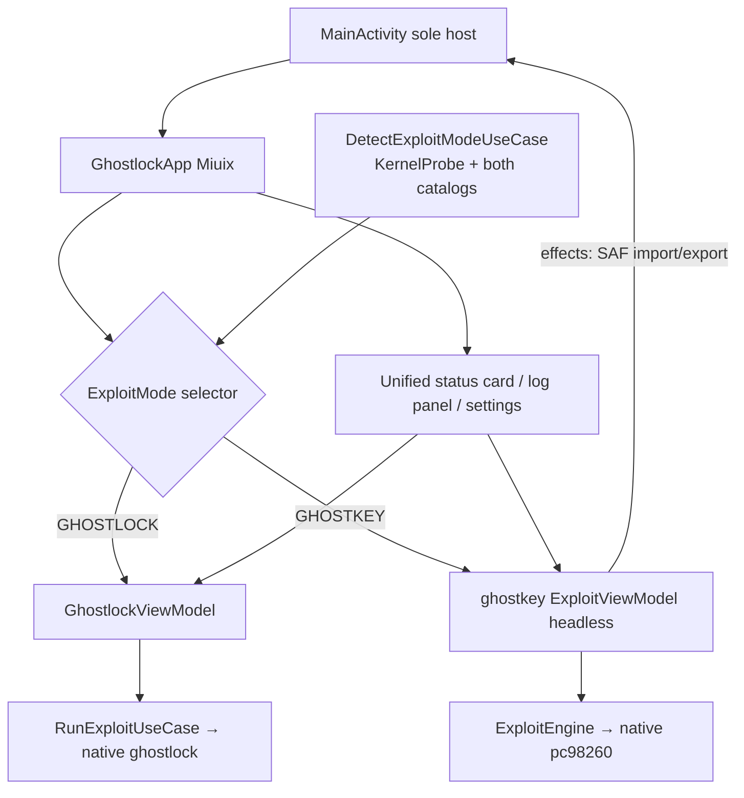

[中文](suite-ui-unification-plan_ZH.md) | English

# Suite UI unification: fold GhostKey into the GhostLock main UI as a headless engine (2026-11-05)

## Status and baseline

- Plan baseline: `d8c4166` (branch `very-not-stable-dev`, clean tree).
- Level: **L** (cross-module contract change: ghostkey's external surface becomes a
  headless engine instead of a UI-carrying Activity).
- Current state: `MainActivity` first renders a "GhostLock Suite" shell home
  (`SuiteHomeUI`, two module cards), which then routes to the in-app `GhostlockApp`
  (Miuix style) or launches a separate `GhostKeyActivity` (Material3 +
  CVE98260Theme, with its own MainScreen/Settings/LogViewer screens). Two visual
  languages and duplicated Shizuku/settings/log surfaces — it reads as a wrapper.

## Problem

1. The shell home is a redundant middle layer; the original GhostLock UI should be
   the only main UI.
2. GhostKey lives as a separate Activity with a separate theme; visuals and
   interaction are disjointed.
3. Shizuku status, settings, and log viewing exist once per module.

## Goals and constraints

Goals (three user-approved decisions):

1. **Main UI = original GhostLock**: delete `SuiteHomeUI`; `MainActivity` renders
   `GhostlockApp` directly.
2. **Exploit engine choice (either/or)**: the main UI offers a GhostLock / GhostKey
   mode selector; the default is auto-detected from `uname -r` (GL-only match → GL;
   GK-only match → GK; both → GL; neither → GL with an unmatched hint). Manual
   switches persist; without an override the auto result applies.
3. **Deep integration (headless)**: GhostKey drops all of its own UI (MainScreen /
   SettingsScreen / LogViewerScreen / GhostKeyActivity / theme) and keeps
   ExploitViewModel / ExploitEngine / data / device / ksu / native; run state,
   five-stage progress, and logs render inside the host's Miuix UI.
4. **Common features keep exactly one copy**: Shizuku status card, settings
   surface, and log panel exist only in the host; in GhostKey mode the same panels
   render GK content (log entries tone-mapped into the host log panel).

Non-goals:

- No native changes (`src/core/` and `ghostkey/src/main/cpp/` untouched) → no
  `cmp_disasm` gate.
- No profile format, wire format, or kernel support list changes on either side.
- Do not merge the modules' internal Shizuku managers (GhostKey's
  `ShizukuPermissionManager` stays independent; its UserService binding logic is
  untouched). "Dedup" applies only to the presentation layer.
- No changes to the GhostLock exploit's own execution flow.

## Design

### Mode model and detection

- Add `enum class ExploitMode { GHOSTLOCK, GHOSTKEY }` (app `domain/model`).
- New detection entry (app-side use case):
  - `uname -r` reuses ghostkey's existing `KernelProbe.read()` (app already
    depends on `:ghostkey`).
  - GhostLock match: exact release match against `BuiltinProfileCatalog`.
  - GhostKey match: a lightweight query added in the ghostkey module (e.g.
    `GhostKeySupportProbe.matchedRelease(release): String?`) backed by its profile
    catalog, avoiding a full `ExploitEngine` construction just for probing.
- Persistence: `SharedPreferences` key `exploit_mode_override`; only explicit user
  choices are stored, otherwise the auto-detected result applies.

### UI structure (after batch B)

- `MainActivity`'s only surface = `GhostlockApp`.
- The main screen (ControlPanel area) gains a mode row (two-segment
  GhostLock / GhostKey with a one-line detection summary); GL running disables GK
  and vice versa (mutual exclusion both ways).
- In GhostKey mode:
  - The Run button triggers ghostkey's `ExploitViewModel.startExploit()`;
  - The execution panel renders GK's five-stage progress (`StageState` list,
    per-stage durations, stageHint);
  - The log panel renders `LogEntry` (mapped to `LogTone`);
  - GK-specific dialogs render in the host: start notice (5 s countdown), inject
    risk, out-of-range kernel confirmation, USB-debug reminder;
  - GK profile import/select/export folds into the host's unified settings surface
    (SAF-based, mirroring GL's DocumentRequest pipeline).
- GhostKey's `ExploitViewModel` gains an effect channel (document pick / export /
  Toast) consumed by `MainActivity` — headless mode means it can no longer own UI.

### Ownership and mutual exclusion

- Both ViewModels are created/held by `MainActivity`; `GhostlockUiState.running`
  and `ExploitUiState.isRunning` disable each other, preventing two kernel
  exploits from running concurrently.
- Mode state lives in `GhostlockViewModel` (single source of truth); GK run state
  is observed by `MainActivity` and injected into the disable logic.

## Batches (one concern per batch; verify before starting the next)

### Batch A: unified entry + auto default mode

- Delete `SuiteHomeUI.kt`; `MainActivity` renders `GhostlockApp` directly.
- `GhostlockUiState` gains mode and detection fields; `GhostlockViewModel` gains
  mode selection/persistence.
- Add `DetectExploitModeUseCase` plus ghostkey's `GhostKeySupportProbe`.
- Main screen gains the mode row; mode = GHOSTKEY temporarily still launches
  `GhostKeyActivity` (intermediate state; GK's UI unchanged).

### Batch B: GhostKey headless + UI absorption

- ghostkey module: delete `ui/` entirely (MainScreen, SettingsScreen,
  LogViewerScreen, GhostKeyActivity, LogTone, theme), remove the Activity from the
  manifest; `ExploitViewModel` gains the effect channel.
- app module: add a Miuix-styled GK panel (stage progress / logs / dialogs); fold
  GK profile import/export into the unified settings surface; move GK's hardcoded
  Chinese strings into app `values/` + `values-zh/`.

## Affected files

- app: `ui/MainActivity.kt`, `ui/SuiteHomeUI.kt` (deleted), `ui/GhostlockUI.kt`,
  `ui/GhostlockViewModel.kt`, `res/values*/strings.xml`, `domain/model/`,
  `domain/usecase/`, new `ui/GhostKeyPanel.kt` (batch B).
- ghostkey: `ui/*` (deleted in batch B), `viewmodel/ExploitViewModel.kt`, a new
  probe object, `AndroidManifest.xml`.

## Invariants

- The two-exploit mutual exclusion holds under any timing (including switching to
  GK while GL runs, and returning to the main screen while GK runs).
- GhostKey engine internals (ExploitEngine, native code, RunLogStore paths) are
  unchanged.
- The GhostLock main UI's existing interactions (execution sheet, profile editor,
  debug export, etc.) do not regress.

## Verification

- `./gradlew :app:assembleDebug` (zero warnings), `:app:testDebugUnitTest`,
  `:ghostkey:testDebugUnitTest` (retained StageTracker tests).
- On-device manual checks (performed by the developer): auto default detection is
  correct (GL-supported device / GK-only device / neither); one full exploit run
  per mode; mutual exclusion holds under concurrent attempts; bilingual strings
  complete.
- Exploit behavior unchanged → no `cmp_disasm`; if a batch unexpectedly touches
  native or the attack dataflow, stop and satisfy the attack-critical-path gate
  first.

## Rollback

- Batch A: restore `SuiteHomeUI.kt` and the original `MainActivity` routing.
- Batch B: restore ghostkey's `ui/` directory and manifest from git history; the
  two batches roll back independently.
