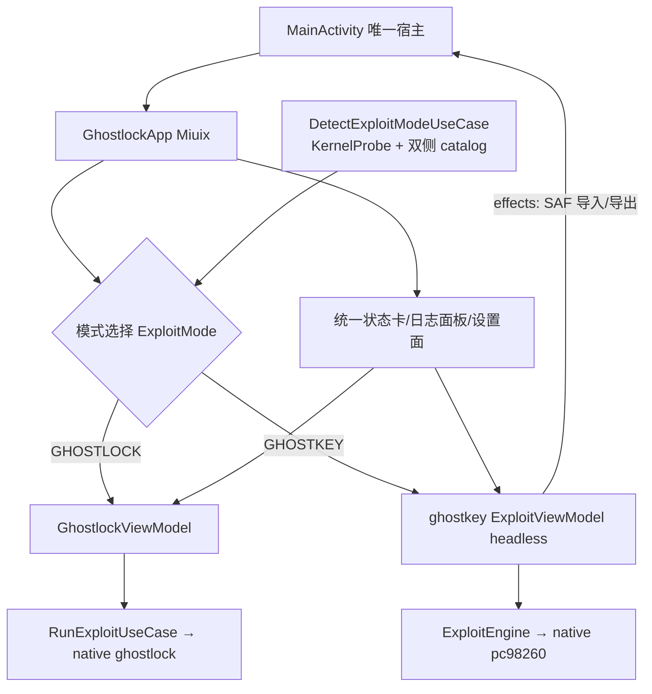

# Suite UI 统一：GhostKey headless 并入 GhostLock 主界面（2026-11-05）

## 状态与基线

- 计划基线：`d8c4166`（分支 `very-not-stable-dev`，工作树干净）。
- 级别：**L**（跨模块契约变更：ghostkey 对外表面由"带 UI 的 Activity"变为"headless 引擎"）。
- 现状：`MainActivity` 先渲染 "GhostLock Suite" 套壳首页（`SuiteHomeUI`，两张模块卡），
  再分发到应用内 `GhostlockApp`（Miuix 风格）或外部 `GhostKeyActivity`
  （Material3 + CVE98260Theme，自带 MainScreen/Settings/LogViewer 三屏）。
  两套视觉语言、两份 Shizuku/设置/日志界面，观感即"套壳"。

## 问题

1. 套壳首页是多余的中间层，用户期望以原 GhostLock 界面为唯一主界面。
2. GhostKey 以独立 Activity + 独立主题存在，视觉与交互完全割裂。
3. Shizuku 状态、设置、日志查看在两个模块各有一份，功能重复。

## 目标与非目标

目标（用户已确认的三项决策）：

1. **主 UI = 原 GhostLock**：删除 `SuiteHomeUI`，`MainActivity` 直接渲染 `GhostlockApp`。
2. **提权引擎二选一**：主界面提供 GhostLock / GhostKey 提权模式选择；
   默认模式由 uname -r 自动探测（只命中 GL→GL；只命中 GK→GK；都命中→GL；
   都未命中→GL 并提示未匹配）。手动切换持久化，无覆盖时回到自动结果。
3. **深集成（headless）**：GhostKey 删除全部自有 UI（MainScreen / SettingsScreen /
   LogViewerScreen / GhostKeyActivity / 主题），保留 ExploitViewModel / ExploitEngine /
   data / device / ksu / native；运行状态、五阶段进度、日志全部渲染进宿主 Miuix 界面。
4. **共同功能仅保留一份**：Shizuku 状态卡、设置面、日志面板只保留宿主一份；
   GhostKey 模式下同一面板切换渲染 GK 的内容（日志按 tone 映射进宿主日志面板）。

非目标：

- 不改任何 native 代码（`src/core/` 与 `ghostkey/src/main/cpp/` 均不动）→ 不触发
  `cmp_disasm` 门禁。
- 不改 profile 格式、wire 格式、两侧内核支持列表。
- 不合并两模块的内部 Shizuku 管理器（GhostKey 的 `ShizukuPermissionManager` 仍独立
  存在，其 UserService 绑定逻辑不动）；"去重"仅指 UI 呈现层只保留宿主一份。
- 不改 GhostLock exploit 自身的任何执行流程。

## 设计

### 模式模型与探测

- 新增 `enum class ExploitMode { GHOSTLOCK, GHOSTKEY }`（app `domain/model`）。
- 新增探测入口（app 侧 use case）：
  - uname -r 复用 ghostkey 模块已有的 `KernelProbe.read()`（app 已依赖 `:ghostkey`）。
  - GhostLock 命中判断：`BuiltinProfileCatalog` 的 release 精确匹配。
  - GhostKey 命中判断：在 ghostkey 模块新增一个轻量查询（如
    `GhostKeySupportProbe.matchedRelease(release): String?`），内部走其 profile 目录
    解析，避免为了探测构造完整 `ExploitEngine`。
- 持久化：`SharedPreferences` 键 `exploit_mode_override`；仅记录用户手动选择，
  未有覆盖时使用自动探测结果。

### UI 结构（批次 B 完成后）

- `MainActivity` 唯一 surface = `GhostlockApp`。
- 主界面（ControlPanel 区域）新增模式选择行（两段式 GhostLock / GhostKey，
  附一句探测结论副文案）；GL 运行中禁用 GK，GK 运行中禁用 GL（双向互斥）。
- 模式 = GhostKey 时：
  - Run 按钮触发 ghostkey `ExploitViewModel.startExploit()`；
  - 执行面板渲染 GK 五阶段进度（`StageState` 列表 + 阶段耗时 + stageHint）；
  - 日志面板渲染 `LogEntry`（映射 `LogTone`）；
  - GK 专属弹窗由宿主渲染：启动须知（5 秒倒计时）、注入风险、内核范围外确认、
    USB 调试未关提醒。
  - GK profile 导入/选择/导出收进宿主统一设置面（经 SAF，与 GL 的
    DocumentRequest 流水线同构）。
- GhostKey 的 `ExploitViewModel` 需补充一个 effect 通道（文档选择/导出/Toast），
  由 `MainActivity` 统一接 SAF launcher——headless 后它不能再自持 UI。

### 所有权与互斥

- 两个 ViewModel 均由 `MainActivity` 创建/持有；`GhostlockUiState.running` 与
  `ExploitUiState.isRunning` 互为对方的禁用条件，杜绝两个内核 exploit 并发。
- 模式状态归 `GhostlockViewModel`（单一状态源），GK 运行状态由 MainActivity 观察
  GK VM 后注入禁用逻辑。

## 批次划分（一批一类，上一批验证通过再进下一批）

### 批次 A：入口统一 + 自动默认模式

- 删除 `SuiteHomeUI.kt`；`MainActivity` 直接渲染 `GhostlockApp`。
- `GhostlockUiState` 增加 `mode` 与探测字段；`GhostlockViewModel` 增加模式选择/持久化。
- 新增 `DetectExploitModeUseCase` + ghostkey 侧 `GhostKeySupportProbe`。
- 主界面新增模式选择行；mode = GHOSTKEY 时 Run 仍临时拉起 `GhostKeyActivity`
  （中间态，GK 原界面原样保留）。

### 批次 B：GhostKey headless 化 + UI 收编

- ghostkey 模块：删除 `ui/` 全部（MainScreen、SettingsScreen、LogViewerScreen、
  GhostKeyActivity、LogTone、theme），manifest 去掉 Activity 声明；
  `ExploitViewModel` 补 effect 通道。
- app 模块：新增 Miuix 风格 GK 面板（阶段进度/日志/弹窗）；统一设置面收编 GK 的
  profile 导入/导出；文案迁入 app `values/`+`values-zh/`（GK 原界面大量硬编码中文）。

## 影响文件

- app：`ui/MainActivity.kt`、`ui/SuiteHomeUI.kt`（删）、`ui/GhostlockUI.kt`、
  `ui/GhostlockViewModel.kt`、`res/values*/strings.xml`、`domain/model/`、
  `domain/usecase/`、新增 `ui/GhostKeyPanel.kt`（批次 B）。
- ghostkey：`ui/*`（批次 B 删除）、`viewmodel/ExploitViewModel.kt`、
  新增探测 object、`AndroidManifest.xml`。

## 不变量

- 两 exploit 运行互斥在任意时序下成立（含 GL 执行中切 GK、GK 执行中返回主界面）。
- ghostkey 引擎内部行为（ExploitEngine、native、RunLogStore 落盘路径）零改动。
- GhostLock 主 UI 既有交互（执行 sheet、profile 编辑、调试导出等）零回归。

## 验证

- `./gradlew :app:assembleDebug`（零警告）、`:app:testDebugUnitTest`、
  `:ghostkey:testDebugUnitTest`（StageTracker 等保留测试）。
- 真机手测（用户执行）：自动默认模式探测正确（GL 支持机 / 仅 GK 支持机 / 双不支持机）；
  两种模式各完整跑一次提权；互斥在并发尝试下成立；bilingual 文案齐全。
- exploit 行为未变 → 无需 `cmp_disasm`；如后续批次意外触及 native/攻击数据流，立即
  停止并按攻击关键路径门槛补全。

## 回滚

- 批次 A：恢复 `SuiteHomeUI.kt` 与原 `MainActivity` 路由即可。
- 批次 B：按 git 历史恢复 ghostkey `ui/` 目录与 manifest；两批次相互独立可回退。
